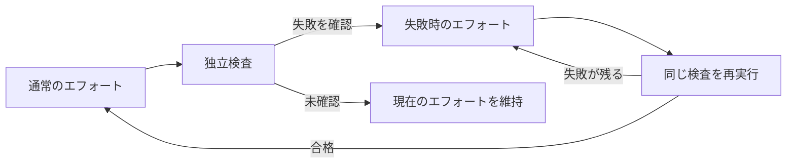

# Test Feedback Loop

**実装も修正も Low で。間違いは、まだ直しやすいうちに見つける。**

AIには小さな単位で実装や修正を任せ、各段階で最初に機械判定できる検査を、AI自身の判断とは別に実行します。「もっと考えて」ではなく、検査で分かったことを次の一手に返します。検査で判断できないときは、推測で修正を重ねず止まります。

たとえば「保存できたと出るのに、再読み込みするとメモが消える」。画面全体の完成を待たず、保存処理やAPIができた時点で「書く → 読み直す」を確かめられます。既存のメモを編集できることも別に確認し、画面でしか分からない部分は後でブラウザーから検査します。

[English](README.md) · [简体中文](README.zh-CN.md) · [Agent Skill](skills/test-feedback-loop/SKILL.md)

**AIでアプリを作っている人へ：** [困った挙動と確認方法を共有する](#早く気づくための確認方法を持ち寄る)。コードは不要です。**自動化したい人へ：** [デモを試す](#修正から再検査まで試す)、または[自分のプロジェクトで確かめる](#自分のプロジェクトで確かめる)。

## 修正から再検査まで試す

Node.js 24 以上 を使います。次の2つのデモは、モデルのアカウントや API キーなしで動きます。

```sh
git clone https://github.com/onoderakosen89/test-feedback-loop.git
cd test-feedback-loop
npm run --silent demo:repair
```

失敗を再現し、台本の修正役に証拠を渡して、同じ異常例と正常例を再検査します。修正が2回とも外れる場合は、次のデモで確認できます。

```sh
npm run --silent demo:repair -- --show-stop
```

終了値は `1` で、2回の経過、最後の差分、失敗の証拠、見直す前提が `consultation` にまとまります。検査が未確認なら終了値は `2` です。相談の表示や配送は呼び出し元で行えます。

`npm run --silent demo:repair -- --chatgpt` では、ChatGPT にサインインした Codex が、使い捨ての試料を固定 Low で直します。修正がもう一度必要なら、同じセッションに新しい検査結果だけを足します。Codex が返した場合はキャッシュ済み入力トークンも表示します。[呼び出し元向けの関数](src/repair-loop.mjs)は既定で2回まで修正し、`maxRepairs` に正の整数を指定すると上限を変えられます。

## 検査から始める作り方

1. **再現する。** 何が通ればよいかを決め、異常例と正常例を一つずつ試します。
2. **小さく直す。** 失敗した検査、期待した結果、実際の結果を Codex や Claude Code に渡します。直す範囲を絞れたら、まず Low を使います。
3. **同じ検査で確かめる。** 異常例が直り、正常例も保たれたことを見ます。原因を絞れず次の修正が推測になるなら、証拠を残して止まります。

実案件の写しで、GPT-6.1 Terra と GPT-6.2 Sol に同じ証拠を渡し、固定 Low と固定 High でそれぞれ1回試しました。4回とも狙った不具合を直し、正常例を維持しました。

| モデル | Low | High |
| --- | --- | --- |
| GPT-6.1 Terra | 45秒・出力1,677トークン・広い検査10/15件 | 67秒・出力2,694トークン・10/15件 |
| GPT-6.2 Sol | 94秒・出力3,137トークン・広い検査11/15件 | 141秒・出力5,347トークン・10/15件 |

**この1件では、固定 Low は固定 High より約33%短時間で、出力トークンは38〜41%少なくなりました。** 両モデルとも両設定で狙った検査を通過しました。入力トークン、キャッシュ分、取りこぼした検査も比較結果に載せています。[比較の条件と結果](docs/implementation-evaluation.md)

## 自分のプロジェクトで確かめる

既存のテストに対して検査コマンドをそのまま使えます。失敗を修正役へ自動で渡す場合は、呼び出し側を [runRepairLoop](src/repair-loop.mjs) につなぎます。検査には信頼できるテストファイルを指定してください。

```sh
npm run check:node -- --cwd /path/to/project --check-id regression --id before test/regression.test.mjs
```

結果、失敗したアサーションの場所、分かる範囲で未確認の理由が出ます。修正後は同じファイル・検査IDで `--id after --resolves before` を付けて実行します。モデルや API キーは不要です。台本から使う場合は `npm run --silent check:node -- --json` に検査の引数を足し、返る `observation` を `RunContext` に渡せます。

| 終了値 | 意味 |
| --- | --- |
| 0 | 検査に合格 |
| 1 | アサーションの失敗を確認 |
| 2 | 未確認、または検査を実行できなかった |

pytest を使う場合は、pytest が入っている Python を指定します。テスト本体のアサーション失敗は証拠付きで返し、テストの収集や準備で止まった場合は未確認にします。

```sh
npm run check:pytest -- --cwd /path/to/project --python /path/to/venv/bin/python --check-id regression --id before tests/test_regression.py
```

別のプロジェクトから直接呼ぶ場合は、このチェックアウトで `npm link` を実行し、対象プロジェクトで `tfl-check --help` を実行します。Python のテストなら `tfl-check --runner pytest --python /path/to/venv/bin/python tests/test_regression.py` です。任意のプロキシも `test-feedback-loop` として起動できます。

## 早く気づくための確認方法を持ち寄る

集めるのは、**何が壊れるか、どの段階なら気づけるか、何を見れば合否が分かるか**の実例です。人が確認できる手順だけでも投稿できます。自動化できる場合は、コマンドと、判定できない場合の扱いも添えてください。

| 層 | 例：保存したメモが消える |
| --- | --- |
| 人が確認できる挙動 | 新規メモを保存して再読み込みし、内容が残れば合格。既存メモの編集も引き続きできることを確かめる。 |
| 最初に機械判定できる地点 | 保存処理やAPIができた時点で、別のクライアントから読み直して内容が一致するか検査する。保存先に接続できないなら不合格ではなく未確認。画面固有の確認は後で足す。 |

[確認方法を投稿する（コード不要）](https://github.com/onoderakosen89/test-feedback-loop/issues/new?template=early-check-recipe.yml) · [検査アダプタを提案する](https://github.com/onoderakosen89/test-feedback-loop/issues/new?template=check-adapter.yml) · [参加ガイド](CONTRIBUTING.md)

標準装備は既存のテストツールです。Node.js と pytest の検査アダプタを同梱していますが、確認方法の投稿に新しいアダプタは必要ありません。

## 任意のエフォート切り替え

検査と修正の手順は固定 Low でも使えます。切り替えを試す場合は、同梱の HTTP プロキシか、Codex と Claude Code の接続例を選べます。[通信仕様](SPEC.md)

### 切り替えのデモ

Node.js 24 以上 で実行します。模擬上流とプロキシをローカルで起動し、終了時に閉じます。API キーや実モデルは不要です。

```sh
npm run demo
```

最初は Low。Node.js のテストが実際に落ちると High。同じテストが修正後に通ると Low に戻ります。権限・承認・利用枠・通信の失敗は引き上げに使いません。



### Codex で直接試す

Codex CLI が入っていれば、`npm run demo:codex` で App Server を起動し、同じスレッドの3ターンで模擬上流に **Low → High → Low** が届くことを確認できます。HTTP プロキシのデモと同じ検査器・切り替え条件を使います。

普段の ChatGPT ログインで試す場合は `npm run demo:codex -- --chatgpt` です。ログイン方法を確認してから、一時の読み取り用作業場所で Codex を3回呼びます。モデルを変える場合は `--model MODEL_ID` を追加できます。この例は専用の App Server セッションを開きます。[Codex App Server の仕様](https://developers.openai.com/codex/app-server)

### Claude Code で直接試す

公式の Claude Code CLI に本人のアカウントでログインした状態で、`npm run demo:claude -- --use-subscription` を実行します。独立検査の結果に応じて `--effort` を設定し、同じ会話を `--resume` で引き継ぎながら3回呼びます。認証とモデル通信は公式 CLI が扱います。[Claude Code CLI の仕様](https://code.claude.com/docs/en/cli-reference)

### デスクトップで使う

開いているデスクトップ会話では、実装後に検査を実行し、結果を見てアプリのエフォート設定から次の値を選べます。上の自動例はそれぞれ専用のセッションで動きます。[Codex の設定](https://learn.chatgpt.com/docs/models?surface=app) · [Claude Desktop の設定](https://code.claude.com/docs/en/desktop)

### HTTP プロキシにつなぐ

```sh
npm start -- --upstream http://127.0.0.1:8317 --model YOUR_MODEL_ID --port 8318
```

呼び出し側の API の基点を `http://127.0.0.1:8318/v1` にし、`src/adapter.mjs` の `RunContext` で検査結果を渡します。実行と再検査の ID の扱いは [通信仕様](SPEC.md) にあります。

起動時に通常時（`--base-effort`、既定は `low`）と、確認済みの失敗が残る間（`--failure-effort`、既定は `high`）の値を指定できます。対応する再検査がすべて通ると通常時の値に戻ります。

| 切り替え | 起動オプション |
| --- | --- |
| High → Low → High | `--base-effort high --failure-effort low` |
| Low → XHigh → Low | `--base-effort low --failure-effort xhigh` |

指定できる値は `none`、`minimal`、`low`、`medium`、`high`、`xhigh`、`max` です。上流のモデルが対応する値を選んでください。

### 同梱の Node.js 検査

`src/checkers/node-test.mjs` の `runNodeTestCheck` にテストファイルと検査IDを渡すと、`RunContext` に渡せる結果を返します。アサーションの失敗は Node.js の構造化イベントで判定します。試験を実行できない場合や理由を分類できない場合は不明として扱います。再検査では同じファイルと検査IDを使い、元の失敗IDを `resolves` に渡します。[接続例](README.md#bundled-nodejs-check)

対象はローカルの信頼できる呼び出し元です。検査、仕事の停止、結果の報告は呼び出し元の役目です。状態はメモリにあり、上流の実行回数は呼び出し元が管理します。

```sh
npm test
npm run test:integration
```

## ライセンス

[MIT](LICENSE)
