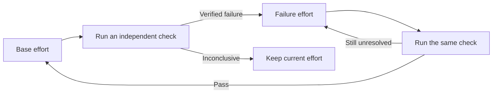

# Test Feedback Loop

**Build quickly with AI by shortening the time from a broken change to a useful test result.**

This project grew out of a practical question from someone who started without a programming background: how can you build reliable software with AI without spending most of your time and tokens on retries? The method focuses on the Check in Plan–Do–Check–Act. Give the coding agent a small, repeatable failure, let it make a targeted change at low reasoning effort, and independently rerun the failing case and a normal control.

[日本語](README.ja.md) · [Agent Skill](skills/test-feedback-loop/SKILL.md)

## The workflow

1. **Reproduce.** Run a small check against the behavior you expect, with a normal case to check for regressions.
2. **Make one bounded change.** Give Codex or Claude Code the failed check, what you expected, and what happened. Low effort is a starting point for a repair this well scoped.
3. **Verify.** Rerun the same check and the normal case. If the result stays inconclusive or the next repair would be guesswork, keep the evidence and stop to review the cause.

In one historical regression trial, a message was dropped before a conversation opened. Codex repaired the failure in one low-effort turn after receiving the reproduction. The original test and the normal comparison both passed on recheck. That trial shows how the workflow can work. The time and token savings compared with a fixed higher effort are still unmeasured.

## Check your own project

Use Node.js 26.10.0 and point the command at a trusted Node.js test file:

```sh
npm run check:node -- --cwd /path/to/project --check-id regression --id before test/regression.test.mjs
```

The output leads with the check result, followed by the failing assertion and its location if available. After a repair, use the same files and check ID, plus `--id after --resolves before`.

| Exit code | Meaning |
| --- | --- |
| 0 | The check passed |
| 1 | An assertion failure was confirmed |
| 2 | The check was inconclusive or could not run |

For machine-readable output, run `npm run --silent check:node -- --json` with your test arguments. Pass `observation` to `RunContext` and keep `evidence` for the repair agent. The check command makes no model calls.

## Share an independent check

Have a useful pytest, Vitest, TypeScript, Cargo, schema, or other check? Open a [check proposal](https://github.com/onoderakosen89/reasoning-effort-controller/issues/new?template=check-adapter.yml) with a small failing example, a passing recheck, and a case where the runner could not determine the result. Proposals are welcome before implementation. If you have a working adapter, open a pull request with those examples as tests. [Contribution guide](CONTRIBUTING.md)

The bundled checker currently supports Node.js tests.

## Optional effort switching

The check and repair workflow works with a fixed effort. For experiments with automatic effort switching, the repository includes a local HTTP controller and examples that call the native Codex and Claude Code interfaces. [Wire specification (Japanese)](SPEC.md)

### Run the switching demo

Use Node.js 26.10.0. The demo starts a mock upstream and the controller on loopback and closes both when it finishes. It needs no dependencies, API keys, or model calls.

```sh
npm run demo
```

```text
Initial call: low
Verified failure: high
Matching check passed: low
```

The demo runs a real Node.js assertion against a temporary implementation, changes the implementation, and runs the same assertion again. The mock upstream reports the effort it received after each check.

### Use Codex without the HTTP proxy

With Codex CLI installed, run `npm run demo:codex`. This starts Codex App Server with a loopback mock and verifies that three turns in one thread send `low → high → low` upstream. It uses the same checker and policy as the HTTP demo.

To try with your existing ChatGPT sign-in, run `npm run demo:codex -- --chatgpt`. This makes three short model calls against your Codex plan in a temporary read-only workspace. Add `--model MODEL_ID` if your plan offers a different model. The example checks the account mode before starting the three turns. It creates its own App Server session. [Codex App Server](https://developers.openai.com/codex/app-server)

### Use the official Claude Code CLI

With Claude Code installed and signed in through its own sign-in flow, run `npm run demo:claude -- --use-subscription`. It makes three short calls in one Claude Code session, setting `--effort` and resuming that session for each follow-up. It uses the same independent check and policy. Claude Code handles all authentication and model calls. [Claude Code CLI reference](https://code.claude.com/docs/en/cli-reference) · [Anthropic's authentication guidance](https://code.claude.com/docs/en/legal-and-compliance#authentication-and-credential-use)

### Desktop sessions

In an open desktop conversation, you can run the project check and manually choose the next effort with the app's built-in control. The automatic examples above own their respective sessions. [Codex desktop model control](https://learn.chatgpt.com/docs/models?surface=app) · [Claude Desktop effort menu](https://code.claude.com/docs/en/desktop)

### How the controller switches

1. The caller starts a run at the configured **base effort** (default: `low`).
2. After an independent check finds a failure attributable to reasoning or generated output, the caller attaches that result to the next request. The controller uses the configured **failure effort** (default: `high`) while a classified failure remains unresolved.
3. When the same check passes, the caller references the original failure. Effort returns to the base level after all outstanding failures have been resolved.

Permission, approval, quota, and transport failures do not raise effort. The controller treats requests without valid context as passthrough. It leaves the contents of model messages, tools, and unrelated request fields intact.



### Connect a caller

```sh
npm start -- --upstream http://127.0.0.1:8317 --model YOUR_MODEL_ID --port 8318
```

Use `http://127.0.0.1:8318/v1` as the caller's API base URL. The upstream must be an HTTP server listening on IPv4 loopback. The controller supports OpenAI-compatible `/v1/chat/completions` and `/v1/responses` requests. The upstream must support the requested effort values.

Set the two levels at startup:

| Sequence | Options |
| --- | --- |
| High → Low → High | `--base-effort high --failure-effort low` |
| Low → XHigh → Low | `--base-effort low --failure-effort xhigh` |

Accepted values are `none`, `minimal`, `low`, `medium`, `high`, `xhigh`, and `max` (case-insensitive). Choose levels your upstream model supports. The options change the values sent at each state while keeping the same switching conditions.

Use `RunContext` from `src/adapter.mjs` to add the `X-Effort-Context` header:

```js
import { RunContext } from './src/adapter.mjs';

const run = new RunContext();
const initialHeaders = run.next();
const repairHeaders = run.next([
  { id: 'failure-1', check_id: 'regression', outcome: 'failure', category: 'reasoning' },
]);
const recheckHeaders = run.next([
  { id: 'pass-1', check_id: 'regression', outcome: 'success', resolves: 'failure-1' },
]);
```

Send these on successive logical calls, alongside your normal request headers. Link an observation to the call that follows the check. On an HTTP retry, reuse that call's exact headers and body. Use a separate run for unrelated work and keep calls within each run in order. Give capability probes and other auxiliary requests their own context or send them without the control header.

### Bundled Node.js check

Use `runNodeTestCheck` after an edit to run an explicit set of trusted test files:

```js
import { runNodeTestCheck } from './src/checkers/node-test.mjs';

const check = { files: ['./test/regression.test.mjs'], checkId: 'regression' };
const observation = await runNodeTestCheck({ ...check, id: 'check-1' });
const nextHeaders = run.next([observation]);
```

For a recheck, use the same files and check ID, a new observation ID, and `resolves` set to the original failure ID. The adapter classifies assertion failures from structured runner events. An incomplete run or an unclassified error does not change the effort state.

## Scope

- Loopback deployment for trusted callers. The context header carries control data and is not an authentication mechanism.
- In-memory decisions. HTTP retries still reach the upstream, and a restart starts a new run.
- The caller runs the checks and owns task success, escalation, or approval. The controller changes reasoning effort and logs its decisions.
- The demo and integration suite use mock models. Live model quality, latency, and token savings have not been measured here.

```sh
npm test
npm run test:integration
```
