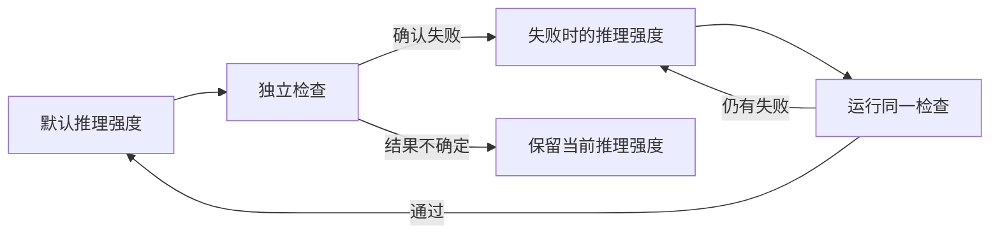

# Test Feedback Loop

**用 Low 实现和修复，在问题还容易改的时候发现它。**

让编码代理用较低推理强度（Low）完成小步实现和修复。每走一步，就独立运行最早能判定行为是否正确的检查。把检查证据交给代理，而不是让它“再想想”。如果检查无法得出结论，就先弄清原因，不要连续猜测和修改。

例如，应用提示笔记已保存，但刷新后笔记消失。无需等整个界面做完：存储层或 API 一就绪，就能检查写入后是否读回原值。保留一条编辑旧笔记的正常用例，等界面就绪后再补上只有浏览器才能验证的部分。

[English](README.md) · [日本語](README.ja.md) · [Agent Skill](skills/test-feedback-loop/SKILL.md)

**用 AI 做应用但不写测试？** [分享现象和检查方法](#分享尽早发现问题的检查方法)，无需代码。**要接入自动化？** [试跑演示](#试跑一次完整的修复流程)。

## 试跑一次完整的修复流程

使用 Node.js 24 或更高版本。以下两个演示无需模型账号或 API 密钥。

```sh
git clone https://github.com/onoderakosen89/test-feedback-loop.git
cd test-feedback-loop
npm run --silent demo:repair
```

演示会重现失败，把断言的证据交给修复脚本，然后独立复查同一个回归用例和正常对照用例。下面的命令可以看到连续两次修复失败时会发生什么。

```sh
npm run --silent demo:repair -- --show-stop
```

该命令以状态码 `1` 退出，并返回 `consultation` 对象。其中包含两次尝试的结果、最终差异、最近一次失败的证据，以及需要复核的前提。检查结果无法确定时，退出码为 `2`。调用方可以显示或转发这份记录。

如已用 ChatGPT 登录 Codex，可以运行 `npm run --silent demo:repair -- --chatgpt`，让 Codex 以固定的 Low 推理强度修复临时示例。需要再次修复时，只向同一个会话追加新的检查结果。若 Codex 提供缓存数据，输出中也会显示缓存的输入 token 数。[调用接口 runRepairLoop](src/repair-loop.mjs)默认最多修复两次，调用方可通过正整数 `maxRepairs` 调整上限。

## 工作流程

1. **复现问题。** 用一个小测试锁定预期行为，同时保留正常对照用例。
2. **进行一次范围明确的修复。** 把失败的检查、预期行为和实际结果交给 Codex 或 Claude Code。修复范围清楚时，可以从 Low 开始。
3. **用同一检查验证。** 再跑一遍失败用例和正常用例。如果结果仍不确定，或者下一次修复只能靠猜测，就保留证据并停下来复核原因。

在一次历史消息投递故障的试验中，GPT-6.1 Terra 和 GPT-6.2 Sol 在固定 Low 和固定 High 两种设置下都修复了目标故障，并保留了正常行为。每种组合各跑了一次。

| 模型 | Low | High |
| --- | --- | --- |
| GPT-6.1 Terra | 45 秒，输出 1,677 token，扩展检查通过 10/15 | 67 秒，输出 2,694 token，通过 10/15 |
| GPT-6.2 Sol | 94 秒，输出 3,137 token，扩展检查通过 11/15 | 141 秒，输出 5,347 token，通过 10/15 |

**在这一次修复中，固定 Low 比固定 High 用时少约 33%，输出 token 少 38%–41%。** 两种模型在两种设置下均通过了目标检查。完整结果还列出了输入量、缓存量和未通过的检查。[评测结果与适用范围（英文）](docs/implementation-evaluation.md)

## 检查自己的项目

可以直接对已有测试运行检查命令。如果要把失败证据自动交给修复代理，请让调用方接入 [runRepairLoop](src/repair-loop.mjs)。只运行可信的测试文件。

```sh
npm run check:node -- --cwd /path/to/project --check-id regression --id before test/regression.test.mjs
```

输出首先显示判定，然后在可用时给出失败的断言和位置。修复后，使用同一批测试文件和同一个检查 ID，并加上 `--id after --resolves before`。

| 退出码 | 含义 |
| --- | --- |
| 0 | 检查通过 |
| 1 | 确认存在断言失败 |
| 2 | 无法确定结果或无法运行检查 |

如果需要机器可读的输出，使用 `npm run --silent check:node -- --json` 并附上相同的检查参数。可以把 `observation` 传给 `RunContext`，并把 `evidence` 交给修复代理。能取得原因时，未确认的结果会附带原因。检查命令本身无需调用模型。

对于 Python 项目，请指定装有 pytest 的解释器。

```sh
npm run check:pytest -- --cwd /path/to/project --python /path/to/venv/bin/python --check-id regression --id before tests/test_regression.py
```

测试主体中的断言失败会产生证据。收集和初始化失败时，结果为未确认。

要从其他项目直接运行，请先在本仓库的工作目录中运行 `npm link`，再到目标项目运行 `tfl-check --help`。检查 Python 测试时，可运行 `tfl-check --runner pytest --python /path/to/venv/bin/python tests/test_regression.py`。可选代理命令为 `test-feedback-loop`。

## 分享尽早发现问题的检查方法

我们收集的是实例：**哪里会出错、最早何时能发现、什么结果算通过**。只投稿人工检查步骤也可以。如果已有自动化版本，欢迎附上运行命令，以及哪些情况应该判为无法确定。

| 层次 | 例子：保存的笔记消失 |
| --- | --- |
| 人能检查的行为 | 保存新笔记并刷新，确认原文仍在；同时确认编辑已有笔记仍然有效。 |
| 最早能自动检查的地方 | 存储层或 API 就绪后，用另一个客户端读回刚写入的笔记并检查内容是否一致。无法连接存储时判为无法确定，而不是业务行为失败。 |

[分享检查方法（无需代码）](https://github.com/onoderakosen89/test-feedback-loop/issues/new?template=early-check-recipe.yml) · [建议新的检查适配器](https://github.com/onoderakosen89/test-feedback-loop/issues/new?template=check-adapter.yml) · [贡献指南](CONTRIBUTING.md)

优先沿用已有工具。仓库内置 Node.js 和 pytest 检查器，但分享检查方法不要求新增适配器。

## 可选的推理强度切换

验证与修复流程可以一直使用固定的推理强度。如需试验自动切换，可运行本地演示。它使用回环地址上的模拟上游，执行真实的 Node.js 断言，并展示失败后切换到 High、复查通过后回到 Low 的过程。演示无需 API 密钥，也无需调用模型。

```sh
npm run demo
```



仓库也提供 Codex App Server 和 Claude Code CLI 示例。桌面会话可独立运行检查，再通过应用自带的设置手动调整推理强度。检查结果、任务是否完成以及何时转交人工由调用方负责。[配置和接入方法（英文）](README.md#optional-effort-switching) · [协议说明（日文）](SPEC.md)

## 许可证

[MIT](LICENSE)
